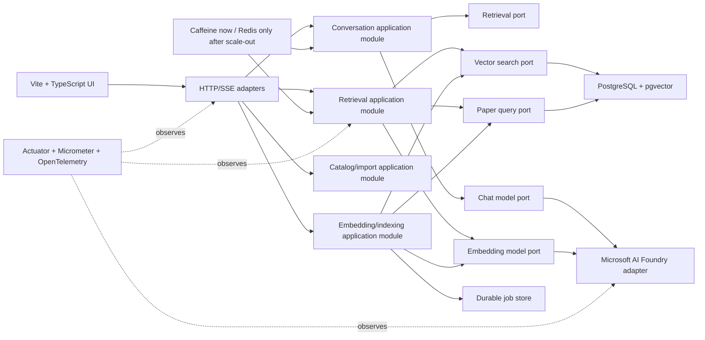

# Entwicklungsplan: architecture, performance, maintainability, and UI

**Project:** arXiv RAG Lab  
**Review date:** 2026-09-14  
**Current baseline:** Spring Boot 4.1 / Java 21, PostgreSQL 18 with pgvector, Microsoft AI Foundry chat and embedding deployments, Caffeine in-process caches, and a static HTML/CSS/JavaScript UI.

## 1. Purpose

This document is the next development roadmap for the project. It is based on the code and documentation currently in the repository, including the already implemented ingestion, embedding, search, grounded chat, streaming, citation, benchmarking, and first-round response-time improvements.

The goals are, in order:

1. Make the code easier to understand, test, and change safely.
2. Reduce chat latency and protect interactive traffic from background work.
3. Make failures visible and recoverable.
4. Complete the useful UI workflows represented by the existing tabs.
5. Prepare for multiple application or model endpoints without paying the complexity cost before it is needed.

This is deliberately not a microservices migration. At the current data size and expected usage, a well-structured modular monolith is simpler, faster to develop, and easier to operate. PostgreSQL with pgvector should remain the primary relational and vector store until measurements demonstrate that it is the bottleneck.

## 2. Current-state assessment

### 2.1 What is already strong

- The application has a complete vertical RAG path: arXiv import, retrieval-document creation, remote embedding, pgvector persistence, lexical/vector/hybrid search, grounded generation, streaming, and citations.
- Paper data, embeddings, checkpoints, and embedding jobs are persisted in PostgreSQL rather than held only in memory.
- Embedding work is restartable and skips unchanged documents.
- The vector table has an HNSW cosine index, while the paper table has full-text, trigram, category, and date-oriented indexes.
- The chat API can stream server-sent events and exposes stage timing information.
- Query-embedding and retrieval caches already use Caffeine.
- The default pre-retrieval chat path avoids an unnecessary model tool-selection round trip. Agentic tool calling is still available when explicitly selected.
- The code already contains useful abstractions such as `EmbeddingModelGateway`, `VectorStoreGateway`, and `GenerationGateway`.
- The repository has unit and integration test infrastructure, including Testcontainers.

### 2.2 Main maintainability risks

The following are the largest current code hot spots:

| Area | Current symptom | Consequence |
|---|---|---|
| Foundry integration | `FoundryClient` owns HTTP transport, retries, chat, embeddings, streaming parsing, error conversion, and response metadata | A change to one Foundry concern can unintentionally affect all others |
| Chat orchestration | `GroundedChatService` owns synchronous chat, streaming, retrieval orchestration, tools, context, and timing | Hard to test one decision independently; the class will continue to grow |
| Provider boundary | Chat orchestration directly uses the Foundry implementation despite the presence of `GenerationGateway` | Provider-specific details leak into application logic |
| UI | `app.js` and `app.css` are large monolithic files | Every tab shares state and rendering behavior; regressions are easy to introduce |
| Streaming UI | The page is broadly re-rendered while tokens arrive | Unnecessary DOM work and risk of losing focus, scroll, or transient state |
| Configuration | Large property objects are mostly validated procedurally | Invalid combinations can fail late and inconsistently |
| Errors | Controllers repeat local exception handlers | The API does not have one stable error contract |
| Jobs | The active embedding `Future` and cancellation state are process-local | Job control becomes unreliable with multiple application replicas |
| Health | `/api/health` returns a static success message | The UI can show green while PostgreSQL, pgvector, or Foundry configuration is unusable |
| Documentation | Multiple divergent documentation trees exist under `docs`, `docs/docs`, `markdown`, and `docs/markdown` | A developer cannot reliably tell which document is authoritative |

### 2.3 Main latency risks

For an uncached grounded chat request, the important path is approximately:

```text
browser
  -> request validation and planning
  -> query embedding over the network
  -> vector and/or lexical retrieval
  -> paper hydration and context construction
  -> Foundry chat request
  -> model time to first token
  -> streamed answer
```

The local HNSW query is already fast after warm-up. The most likely dominant costs are the two network/model stages: query embedding and chat generation. Local improvements still matter, but optimizing a 2–100 ms database stage cannot by itself remove several seconds of model latency.

Important secondary issues are:

- A no-evidence request can still pay for a chat-model call even though the safe answer is already known.
- Bulk embedding and interactive query embedding share the same provider/deployment capacity unless the application gives them separate priorities.
- Concurrent identical cache misses can create duplicate provider calls unless loading is single-flight.
- Context and output limits are largely static rather than selected from the user intent.
- The browser's full-page rendering during a stream can make the response feel less responsive even when server time is unchanged.

## 3. Target architecture

The target is a modular monolith with explicit internal APIs and provider/database adapters.



### 3.1 Proposed module boundaries

Use package-by-feature, with a small public API and package-private internals in each module:

```text
com.example.arxivrag
  catalog
    api
    application
    internal
  indexing
    api
    application
    internal
  retrieval
    api
    application
    internal
  conversation
    api
    application
    internal
  model
    api
    foundry
    offline
  operations
    api
    internal
  web
```

The dependency direction should be:

```text
web -> application APIs
conversation -> retrieval API + model API
retrieval -> catalog API + vector/model APIs
indexing -> catalog API + vector/model APIs + durable jobs
adapters -> application ports
```

Do not add an interface around every Spring Data repository. Add ports at boundaries that are volatile, expensive, external, or need a test double: AI providers, vector storage, job storage, caching, and time. Ordinary internal persistence can remain Spring Data based.

Spring Modulith is a good fit because it can verify module cycles and forbidden access while retaining one deployable Spring Boot application. Its verification rules can enforce API-only module access and allowed dependencies ([Spring Modulith verification](https://docs.spring.io/spring-modulith/reference/verification.html)).

## 4. Priority and release policy

### 4.1 Priority definitions

- **P0:** correctness, security, or a prerequisite for safe future changes.
- **P1:** high-value maintainability, latency, or operational improvement.
- **P2:** useful product or scale preparation that should follow measured P0/P1 results.
- **P3:** conditional work; implement only after its trigger is met.

### 4.2 Delivery rules

Every step below must:

1. Start with a baseline test or measurement.
2. Be delivered in a small change that can be reviewed independently.
3. Preserve existing API behavior unless the step explicitly introduces a versioned replacement.
4. Include unit or integration tests appropriate to the risk.
5. Run Flyway validation and the full Maven test suite.
6. Update the canonical documentation in the same change.
7. Record before/after latency when the step is performance related.

Database migrations are immutable after they have been applied. A schema correction must be a new migration; an old migration must never be edited to make a checksum error disappear.

## 5. Phase 0 — establish reliable baselines and documentation

### Step 0.1 — Create a repeatable quality and latency baseline (P0)

**Problem:** Optimizations cannot be evaluated safely without knowing whether they improved speed at the cost of retrieval or answer quality.

**Implementation:**

1. Expand the existing benchmark data into at least 30 representative cases:
   - exact arXiv identifier lookup;
   - title or author lookup;
   - topical semantic query;
   - category/date filtered query;
   - comparison of two or more papers;
   - query with no supporting paper;
   - adversarial prompt asking the model to ignore evidence.
2. Store the expected paper identifiers and whether an answer should or should not be generated.
3. Record retrieval Recall@k, MRR, citation validity, unsupported-citation count, answer-grounding result, input/output tokens, and cost estimate.
4. Record latency distributions rather than one sample: p50, p90, and p95 for search, time to first token (TTFT), and total response time (TTLT).
5. Run cold-cache and warm-cache suites separately.
6. Save the machine-readable result under `benchmarks/results` with application commit, profile, deployment, prompt version, index version, and corpus generation.

**Acceptance criteria:**

- A single documented command creates a reproducible JSON result.
- Every later performance change can compare itself with this baseline.
- A change is rejected if citation validity or retrieval recall declines beyond an agreed tolerance, initially 2% absolute.

### Step 0.2 — Define service-level objectives (P0)

Use the baseline to finalize targets. Initial working targets are:

| Signal | Initial target |
|---|---|
| Warm lexical search p95 | below 250 ms |
| Warm semantic/hybrid search p95 | below 1.5 s, including remote query embedding |
| Chat TTFT p50 | below 4 s |
| Chat TTFT p95 | below 8 s |
| No-evidence response p95 | below 300 ms |
| Citation URL validity | 100% |
| Provider error rate | below 1% outside provider incidents |
| UI update after an SSE token | below 100 ms |

If the selected Foundry chat deployment cannot meet the TTFT objective after prompt and reasoning tuning, the correct action is to evaluate a faster model deployment, not to keep tuning PostgreSQL.

### Step 0.3 — Consolidate documentation (P1)

**Implementation:**

1. Make `docs/README.md` the documentation index.
2. Declare one canonical location for each subject: architecture, decisions, dataset, operations, implementation history, and future roadmap.
3. Compare the divergent copies in `docs/docs`, `markdown`, and `docs/markdown` with their canonical documents.
4. Move still-useful unique content into the canonical document.
5. Delete or archive the stale duplicate trees only after the comparison.
6. Add a short header to each plan indicating status: proposed, active, completed, or superseded.
7. Link this file from `docs/README.md` after the plan is accepted.

**Acceptance criteria:** A new developer can start at `docs/README.md` and finds only one authoritative version of every document.

## 6. Phase 1 — refactor into a modular monolith

### Step 1.1 — Add executable architecture rules (P0)

**Implementation:**

1. Introduce Spring Modulith's core and test support without changing runtime behavior.
2. Define the six modules from Section 3 using package structure and, where helpful, `@ApplicationModule` and `@NamedInterface`.
3. Add a test that runs `ApplicationModules.of(ArxivRagApplication.class).verify()`.
4. Add targeted ArchUnit rules for constraints that are clearer at class level:
   - web controllers depend only on module APIs/application services;
   - application modules do not import Foundry implementation classes;
   - model adapters do not depend on web DTOs;
   - no dependency cycles.
5. Generate a module diagram during documentation builds or CI.

**Why:** Architecture rules that exist only in prose decay. Executable rules fail as soon as a boundary is crossed.

**Acceptance criteria:** The build fails on a cyclic module dependency or direct import of a Foundry adapter from conversation logic.

### Step 1.2 — Introduce stable model-provider ports (P0)

Create small capability-oriented interfaces:

```java
interface ChatModelGateway {
    ChatModelResult generate(ChatModelRequest request);
    void stream(ChatModelRequest request, ChatTokenListener listener);
}

interface EmbeddingModelGateway {
    List<EmbeddingVector> embed(List<String> inputs, EmbeddingWorkClass workClass);
}
```

Implementation sequence:

1. Move provider-neutral request/result records into `model.api`.
2. Make chat orchestration depend on `ChatModelGateway`, not `FoundryClient`.
3. Keep `EmbeddingModelGateway`, but add the work class `INTERACTIVE` or `BULK` so quota policy can distinguish query embeddings from ingestion.
4. Convert Foundry-specific exceptions to provider-neutral failure types at the adapter boundary.
5. Keep the deterministic offline implementation as a test/dev adapter.
6. Remove the unused or overlapping `GenerationGateway` after all callers use the new API.

**Acceptance criteria:** Conversation and retrieval tests run with fake model gateways and contain no Foundry types.

### Step 1.3 — Split `FoundryClient` by responsibility (P1)

Refactor without changing the wire protocol:

1. `FoundryHttpTransport`: base URI, authentication header/token, connection reuse, request timeout, request ID, and safe logging.
2. `FoundryChatClient`: chat request mapping and non-streaming response mapping.
3. `FoundryStreamingChatClient`: SSE request and token event handling.
4. `FoundryEmbeddingClient`: embedding batching and response mapping.
5. `FoundrySseParser`: retain as a focused parser with malformed-event tests.
6. `FoundryRetryPolicy`: retry classification and backoff.
7. `FoundryQuotaPolicy`: RPM/TPM accounting and workload priority.
8. `FoundryErrorMapper`: HTTP/provider response to a stable domain failure.

Keep one singleton HTTP client so connections are pooled and reused. Do not add WebFlux solely for this refactor; the current JDK HTTP client is suitable if transport and streaming responsibilities are separated cleanly.

**Acceptance criteria:** Each class has one reason to change, request/response mapping has fixture-based tests, and streaming parser tests cover split/multiple/malformed SSE events.

### Step 1.4 — Split chat orchestration (P1)

Create focused collaborators:

- `ChatUseCase`: validates and owns the use-case transaction boundary.
- `ChatRouteSelector`: chooses local answer, pre-retrieval, or agentic execution.
- `PreRetrievalOrchestrator`: retrieves first, then calls the model once.
- `AgenticChatOrchestrator`: handles the optional tool-call loop.
- `ChatPromptFactory`: builds a versioned prompt.
- `GroundedContextBuilder`: retains only context selection/formatting.
- `CitationResolver`: converts model citation handles to authoritative paper metadata and URLs.
- `ChatTelemetry`: stage timing and outcome metrics.
- `ChatStreamPublisher`: converts application events to SSE events at the web boundary.

Synchronous and streaming endpoints should invoke the same use case. They should differ only in how result events are delivered. This prevents the two paths from developing different retrieval or safety behavior.

**Acceptance criteria:** The same test vectors produce equivalent final content and citations in streaming and non-streaming modes.

### Step 1.5 — Standardize executors and structured concurrency (P1)

1. Define named executor beans for interactive retrieval and background jobs.
2. Inject them; do not create executors inside services.
3. Bound submitted interactive work with a semaphore/bulkhead even if virtual threads are used. Virtual threads reduce thread cost but do not create extra Foundry quota or database capacity.
4. Ensure every parallel retrieval branch has the request deadline and is cancelled when the request is cancelled.
5. Shut executors down through Spring lifecycle hooks.
6. Remove compatibility constructors that instantiate default property objects inside production classes.

**Acceptance criteria:** A cancellation closes retrieval/model work promptly, executor count is visible in one configuration class, and tests cannot accidentally obtain production defaults.

## 7. Phase 2 — API, configuration, and clean-code consistency

### Step 2.1 — Validate configuration at startup (P0)

1. Add Jakarta Bean Validation annotations to `FoundryProperties`, `ChatProperties`, and embedding/import properties.
2. Mark property classes with `@Validated`.
3. Validate cross-field rules in focused validators, for example:
   - endpoint must be HTTPS outside the local profile;
   - dimensions must match the database vector schema;
   - batch size and RPM/TPM limits must be positive;
   - context-per-paper cannot exceed total context;
   - cache TTL and capacity must be sensible when enabled.
4. Replace silent defaults for deployment names in the Foundry profile with an explicit startup failure.
5. Add tests for invalid configuration combinations.

**Why:** Failing in seconds at startup is better than failing after a paid provider request or a partially completed embedding job.

### Step 2.2 — Create one HTTP error contract (P1)

1. Add a global `@RestControllerAdvice`.
2. Return RFC-style `ProblemDetail` responses with `type`, `title`, `status`, `detail`, `requestId`, and an application error code.
3. Map validation failures to 400, missing papers/jobs to 404, conflicts to 409, quota/admission rejection to 429, provider unavailability to 503, and provider deadline to 504.
4. Never return raw Foundry response bodies, secrets, SQL, or stack traces.
5. Delete duplicated controller-local exception handlers.

Spring MVC supports global exception handling through controller advice ([Spring MVC controller advice](https://docs.spring.io/spring-framework/reference/web/webmvc/mvc-controller/ann-advice.html)).

**Acceptance criteria:** Every API error, including streaming setup failure, has a documented stable shape and request ID.

### Step 2.3 — Separate domain, persistence, and web DTOs (P1)

1. Use immutable Java records for API commands/results.
2. Do not serialize JPA entities directly.
3. Replace broad `Map<String, Object>` results with typed records.
4. Introduce purpose-built query projections such as `RetrievedPaper`, rather than loading a full entity and mapping it later.
5. Centralize arXiv URL construction and identifier normalization in a value object.
6. Keep mapping at module boundaries.

### Step 2.4 — Version and document the API (P2)

1. Publish `/api/v1/...` routes while temporarily retaining existing aliases.
2. Generate an OpenAPI document with request examples and error contracts.
3. Document SSE event types, ordering, cancellation, and terminal error behavior separately because ordinary OpenAPI descriptions are insufficient for streams.
4. Add contract tests against the generated schema.
5. Remove old aliases only in a later explicitly announced breaking release.

### Step 2.5 — Make feature flags real (P1)

The runtime configuration currently exposes feature states to the UI, but display state must match server behavior.

1. Gate optional controllers/services with `@ConditionalOnProperty`, or remove a flag if the feature is always available.
2. Return disabled capabilities from a typed `/api/v1/capabilities` response.
3. Make the UI hide or disable actions based on that response.
4. Add a startup report explaining which provider, vector store, and optional commands are active without exposing secrets.

## 8. Phase 3 — caching strategy

### 3.1 Decision: Caffeine now, Redis later

Caffeine is the correct cache for the current single application process: it is very fast, has no network hop, and is already integrated. Redis would add another service, persistence policy, security surface, and failure mode without improving a single-instance deployment.

Add Redis only when at least one of these is true:

- two or more application replicas need consistent cache invalidation;
- duplicate provider calls across replicas materially affect latency or cost;
- cache warm-up after deployment is an operational problem;
- session or distributed coordination data has a real use case.

Spring's cache abstraction can hide providers, but multi-process behavior still belongs to the provider, and only deterministic work should be cached ([Spring cache strategies](https://docs.spring.io/spring-framework/reference/integration/cache/strategies.html)). For this project, a small explicit cache port is preferable because keys, single-flight behavior, and metrics are important domain decisions.

### Step 3.1 — Centralize cache definitions and key versions (P0)

1. Create a `CacheConfiguration` that is the only place constructing caches.
2. Create typed key records:
   - `QueryEmbeddingKey(normalizedQuery, model, dimensions)`;
   - `RetrievalKey(query, mode, filters, topK, corpusVersion, retrievalVersion)`;
   - optional `AnswerKey(...)`.
3. Include prompt/retrieval/index versions where a behavioral change would make an old value unsafe.
4. Normalize whitespace and case only where semantics permit it; do not remove meaningful identifiers or operators.
5. Give each cache an independent capacity and TTL.
6. Export hit, miss, load duration, eviction, failure, and current-size metrics.

### Step 3.2 — Make provider-backed cache loading single-flight (P0)

1. Replace manual get/compute/put retrieval loading with atomic `cache.get(key, mappingFunction)` or an `AsyncLoadingCache`.
2. Store the future immediately so concurrent identical requests await one provider call.
3. Remove a failed future so the next request can retry.
4. Do not let a cancelled caller cancel work still needed by other waiters.
5. Add a concurrency test that launches 20 identical requests and asserts one embedding/retrieval execution.

Caffeine recommends asynchronous loading when a computation should be established immediately to prevent a cache stampede ([Caffeine cache stampede guidance](https://github.com/ben-manes/caffeine/wiki/Faq)).

### Step 3.3 — Add short negative caching (P1)

1. Cache an empty retrieval result for only 30–60 seconds.
2. Include corpus generation in the key so a new import invalidates it naturally.
3. Distinguish a genuine empty result from a provider/database failure; never cache the failure as “no papers”.
4. Track negative-cache hit rate.

This prevents repeated impossible queries from repeatedly calling the embedding deployment without hiding newly imported data for long.

### Step 3.4 — Add an optional exact-answer cache (P2)

This cache is disabled by default because an answer is a user-visible model output and can become stale.

If benchmark data shows many exact repeats:

1. Cache only stateless requests with deterministic settings.
2. Include normalized question, filters, retrieval result identifiers and content hashes, model deployment/version, reasoning effort, output budget, prompt version, and corpus version in the key.
3. Use a short TTL, initially five minutes.
4. Return citations from the cached authoritative metadata, not from unchecked model text.
5. Expose `cacheStatus=HIT|MISS` in diagnostics.
6. Do not cache provider errors, cancellations, or unsafe/no-evidence decisions unless they have their own short policy.

### Step 3.5 — Exploit provider prompt caching only when measurable (P1)

Azure prompt caching works when the first 1,024 or more prompt tokens are identical; placing stable instructions first improves the chance of a hit, and usage reports cached input tokens ([Azure prompt caching](https://learn.microsoft.com/en-us/azure/ai-services/openai/how-to/prompt-caching)).

1. Put stable system and tool instructions before dynamic question/evidence content.
2. Version the stable prefix explicitly.
3. Do not pad a short prompt merely to cross the caching threshold.
4. Capture `cached_tokens` in metrics and benchmark output.
5. Consider a stable `prompt_cache_key` only after confirming the deployed API/model supports it.
6. Keep dynamic evidence after the stable prefix.

**Acceptance criterion:** Keep the change only if cached-token rate or TTFT/cost improves on realistic traffic without increasing total prompt size materially.

### Step 3.6 — Prepare distributed invalidation, but do not deploy it yet (P3)

When Redis becomes justified:

1. Persist a monotonically increasing `corpus_version` in PostgreSQL.
2. Increment it transactionally after a successful import or embedding publication.
3. Include it in distributed retrieval/answer cache keys.
4. Publish invalidation events through Redis only as a speed optimization; PostgreSQL remains the source of truth.
5. Keep local L1 Caffeine and Redis L2 only if measurements show the extra complexity is worthwhile.

## 9. Phase 4 — reduce chat response time

Implement these in order and benchmark after each step. Do not combine them into one unmeasurable change.

### Step 4.1 — Return deterministic local answers when generation adds no value (P0)

1. If an exact arXiv ID is requested and not present, return a local “not found in the indexed corpus” answer.
2. If retrieval produces no evidence above the configured threshold, return a local grounded no-evidence answer and suggestions to broaden filters.
3. If required filters are contradictory, report that locally.
4. Preserve a diagnostic reason such as `NO_EVIDENCE`, `MISSING_ID`, or `INVALID_FILTER_RANGE`.

**Why:** This removes the whole chat-model network call and also guarantees that the model cannot invent unsupported references.

**Acceptance criteria:** No chat model call is recorded for these routes; p95 is below 300 ms after any required search.

### Step 4.2 — Introduce intent-based retrieval and output budgets (P1)

Create a deterministic `QuestionIntentClassifier` first; do not use another model call for routing.

Suggested intents:

| Intent | Retrieval/context policy | Output policy |
|---|---|---|
| Exact paper lookup | identifier/title lexical first, top 1–2 | concise metadata and summary |
| Definition/fact | hybrid top 3 | short answer |
| Comparison | hybrid top 5–6 with diversity | structured comparison |
| Literature survey | hybrid top 8 with category/date diversity | longer synthesis |
| Unsupported/general chat | no-evidence policy | explain corpus scope |

1. Start with transparent rules based on ID format, comparison words, filters, and requested list size.
2. Set top-k, maximum context, and maximum output tokens by intent.
3. Log the selected intent and budgets.
4. Add it to the evaluation matrix.

**Why:** Most questions do not need four full context blocks and 400 output tokens. Fewer input/output tokens reduce model work and often improve TTFT/TTLT.

### Step 4.3 — Add lexical-first fast paths (P1)

1. For exact ID, quoted title, clear author, and narrowly structured filter queries, start with relational/full-text search.
2. Skip query embedding when lexical confidence is high enough.
3. Fall back to hybrid retrieval when confidence is low.
4. Continue to run lexical and semantic branches concurrently for genuinely hybrid queries.
5. Benchmark false-fast-path cases so semantic recall is not sacrificed.

### Step 4.4 — Apply a query-embedding deadline with lexical fallback (P0)

1. Give interactive query embedding a short independent deadline, initially 2 seconds and then tune from metrics.
2. If the deadline is exceeded, continue with lexical retrieval rather than failing the whole chat.
3. Mark the response `degradedRetrieval=true` and report the reason in diagnostics, not in normal answer prose unless relevant.
4. Do not apply this fallback to bulk embedding, where silently substituting another vector would corrupt the index.

**Acceptance criteria:** An embedding-provider timeout still produces a valid lexical answer when evidence exists.

### Step 4.5 — Collapse vector retrieval and paper hydration into one SQL projection (P1)

The current vector path first returns identifiers/scores and then hydrates papers through another repository call.

1. Create one SQL query or CTE that finds nearest embedding rows and joins the required paper columns.
2. Return a typed `RetrievedPaper` projection containing paper metadata, document text, similarity, and retrieval source.
3. Preserve ANN filtering and ordering in the inner query before joining.
4. Compare `EXPLAIN (ANALYZE, BUFFERS)` before and after.
5. Keep the old implementation behind a test-only comparison until result equivalence is proven.

### Step 4.6 — Bind vectors as a typed PostgreSQL value (P1)

1. Add the official pgvector Java binding supported by the selected JDBC layer.
2. Bind one `PGvector` parameter rather than repeatedly producing a large textual vector and casting it in SQL.
3. Reuse that bound value for score and order calculations through a CTE.
4. Add integration tests against the PostgreSQL pgvector container.

The official pgvector Java project supports JDBC and Spring integrations and typed `PGvector` values ([pgvector-java](https://github.com/pgvector/pgvector-java)).

### Step 4.7 — Configure model reasoning effort per request class (P1)

For supported Foundry models, lower reasoning effort can reduce latency and token usage. Azure documents `none` for latency-sensitive retrieval and classification scenarios, but exact support must be verified for the deployed model ([Azure reasoning models](https://learn.microsoft.com/en-ie/azure/ai-foundry/openai/how-to/reasoning?view=foundry)).

1. Add a provider-neutral reasoning-effort option to `ChatModelRequest`.
2. Default simple grounded answers to `none` or `minimal` only if supported.
3. Allow `low` for comparison/synthesis.
4. Keep agentic mode configurable separately.
5. Benchmark answer quality, citation validity, TTFT, TTLT, and token cost for each setting.
6. If an option is unsupported, fail configuration clearly or omit the wire field; do not retry blindly with altered semantics.

### Step 4.8 — Evaluate a faster chat deployment (P1)

Model latency will likely remain the largest component.

1. Deploy one candidate small/fast chat model alongside the current deployment.
2. Run the same benchmark suite against both with identical retrieval evidence and prompt version.
3. Compare p50/p95 TTFT, total time, grounding, citation accuracy, answer completeness, and estimated cost.
4. Route simple intents to the fast model only if quality stays within the agreed tolerance.
5. Keep the existing model for complex comparison/synthesis if it produces materially better answers.

This can become a deliberate model router, but it must not be random load balancing: intent and quality determine the route.

### Step 4.9 — Reduce context without losing evidence (P2)

1. Replace fixed per-paper truncation with sentence-aware extraction around matched terms.
2. Remove duplicate title/category/abstract text across context sections.
3. Apply a simple local diversity rule so top results do not all represent near-duplicate papers.
4. Add Maximal Marginal Relevance only if the simpler rule is insufficient.
5. Measure answer quality at 2,000, 3,000, and 4,000 context characters.
6. Keep full metadata available for citation resolution even when model context is shortened.

### Step 4.10 — Evaluate a smaller embedding representation side by side (P3)

Do not overwrite the working 1,536-dimensional index.

1. Create a versioned side table and index for a candidate lower dimension only if the provider supports dimension reduction.
2. Re-embed the benchmark corpus into the new version.
3. Compare Recall@k, MRR, index size, ingestion rate, and query latency.
4. Promote the new version only if quality stays inside the acceptance threshold and resource gains are meaningful.
5. Migrate by a new Flyway migration and an explicit active-index version; never change the existing vector column in place.

At roughly 17,000 papers, this is primarily an experiment in cost and future scale, not a current necessity.

### Step 4.11 — Improve perceived latency in the UI (P1)

1. Render retrieval-stage progress immediately: validating, retrieving, evidence ready, waiting for model, generating.
2. Update only the active assistant message as tokens arrive; do not rebuild the entire page.
3. Batch DOM writes to one animation frame.
4. Preserve scroll position and auto-scroll only when the user is already near the bottom.
5. Show TTFT after the first token and total time at completion.
6. Keep cancel available from request start, not only after the first token.

## 10. Phase 5 — retrieval quality and PostgreSQL efficiency

### Step 5.1 — Make retrieval policy explicit and versioned (P1)

1. Introduce a `RetrievalPolicy` record containing mode, lexical/vector weights, top-k, thresholds, filters, diversity, and version.
2. Configure policies by question intent rather than scattering numeric values through services.
3. Include policy version in cache keys and benchmark output.
4. Keep Reciprocal Rank Fusion weights configurable.
5. Add unit tests with fixed lexical and vector rankings.

### Step 5.2 — Add retrieval-quality metrics (P1)

1. Track empty-result rate and result count by mode.
2. Track similarity score distributions rather than choosing a threshold from intuition.
3. Track how often cited papers came from lexical, vector, or both branches.
4. Calculate Recall@k, MRR, and nDCG in the benchmark runner.
5. Create a small manually reviewed “golden retrieval” set.

### Step 5.3 — Tune filtered HNSW only after recall tests (P2)

Category/date filters can reduce approximate-search recall because filtering and ANN scanning interact.

1. Compare exact search with HNSW for the filtered benchmark cases.
2. If recall is poor, test pgvector iterative index scans and `hnsw.ef_search` using transaction-local settings.
3. Evaluate partial indexes only for stable high-volume categories; do not create one per arbitrary filter.
4. Record index size, query buffers, and p95 latency.
5. Keep the smallest setting that meets the recall target.

pgvector explicitly recommends measuring approximate recall against exact search and provides iterative scans for filtered ANN queries ([pgvector documentation](https://github.com/pgvector/pgvector)).

### Step 5.4 — Add database query observability (P1)

1. Enable `pg_stat_statements` in the development compose environment.
2. Tag important SQL operations in application metrics.
3. Capture slow query count and normalized query p95.
4. Add index/table size and dead-tuple information to the operations UI.
5. Run `ANALYZE` after large imports or index publication; do not expose unrestricted SQL maintenance endpoints.

### Step 5.5 — Add cursor-based paper browsing (P1)

1. Expose a typed paper query API with cursor pagination by `(submittedDate, id)` or another stable unique ordering.
2. Support category, date, author, title, embedded/not-embedded, and stale-embedding filters.
3. Avoid offset pagination for deep result pages.
4. Return only list columns; load the abstract/detail on demand.
5. Add composite indexes only after verifying query plans.

### Step 5.6 — Treat full-text chunking as a versioned future experiment (P3)

The current arXiv metadata/abstract corpus is valid for this project stage. If full PDFs are added:

1. Store source document and chunk records separately.
2. Version parser, splitter, embedding model, dimensions, and chunk policy.
3. Retain page/section provenance for citations.
4. Run chunk-level retrieval alongside, not on top of, the existing paper-level index.
5. Compare answer quality and cost before making it the default.

Milvus or another vector database should be evaluated only if PostgreSQL demonstrably cannot meet corpus size, write rate, filtering, or availability requirements. It should not be introduced merely because the project uses AI.

## 11. Phase 6 — provider resilience and workload isolation

### Step 6.1 — Reserve capacity for interactive traffic (P0)

Bulk ingestion must not make chat search unresponsive.

1. Add `INTERACTIVE` and `BULK` work classes to embedding requests.
2. Reserve a configurable portion of request and token capacity for interactive query embeddings.
3. Let bulk ingestion consume only the remainder and back off when interactive demand is present.
4. Use bounded queues; do not accumulate an unlimited number of virtual threads waiting for quota.
5. Expose queue depth, wait time, rejection count, and capacity by work class.
6. Make ingestion progress explicitly show `WAITING_FOR_PROVIDER_CAPACITY` rather than appearing frozen.

### Step 6.2 — Add deadlines, retry budgets, and circuit breaking (P0)

1. Define one end-to-end deadline for each interactive request.
2. Allocate stage budgets for query embedding, retrieval, and generation.
3. Retry only transient, idempotent failures such as selected 429/5xx/network errors.
4. Respect `Retry-After` when present.
5. Use jittered exponential backoff within the original deadline.
6. Add a circuit breaker around each Foundry operation/deployment.
7. Avoid double retries between the HTTP adapter and a resilience library; one layer owns retries.
8. Return 429 when local admission control is full, 503 when the provider circuit is open, and 504 on deadline exhaustion.

Before choosing a library, verify its Spring Boot 4 compatibility. Resilience4j is a candidate; a small custom policy is acceptable if it remains simpler than adding an incompatible starter.

### Step 6.3 — Make embedding/import job control durable (P1)

1. Persist a job row and return its real ID before submitting background work.
2. Persist `QUEUED`, `RUNNING`, `WAITING`, `CANCEL_REQUESTED`, `SUCCEEDED`, and `FAILED` state transitions.
3. Store owner instance, lease expiry, heartbeat, progress counts, last processed key, and a sanitized error.
4. Make cancellation a persisted request that the worker polls between batches.
5. On startup, recover expired `RUNNING` leases to `QUEUED` or `FAILED_RETRYABLE` according to policy.
6. Retain the PostgreSQL advisory lock as a simple single-worker guard initially.
7. For multiple replicas, claim jobs with a lease/`FOR UPDATE SKIP LOCKED` rather than a process-local `Future`.

### Step 6.4 — Add request correlation and safe logs (P1)

1. Accept or create a request ID at the HTTP boundary.
2. Propagate it through retrieval, SQL observations, Foundry headers where supported, and SSE events.
3. Use structured logs with operation, deployment, status, duration, attempt, and token counts.
4. Never log API keys, authorization headers, complete prompts, full abstracts, or unredacted provider error bodies.
5. Sample successful high-volume logs but retain metrics.

### Step 6.5 — Move to keyless Foundry authentication before cloud hosting (P1)

1. Keep the API key in a user environment variable for local development.
2. Add a Foundry credential strategy that can obtain a bearer token using Azure `DefaultAzureCredential`.
3. Assign the deployed application a managed identity and grant only the required model-inference role.
4. Prefer managed identity in cloud profiles; retain API-key authentication only as an explicit local fallback.
5. Confirm that logs and runtime-config endpoints expose only whether a credential is configured, never its value.

`DefaultAzureCredential` supports local developer credentials and Azure-hosted managed identities through one credential chain ([Azure keyless connections](https://learn.microsoft.com/en-us/azure/developer/ai/keyless-connections)).

## 12. Phase 7 — observability, health, and operations

### Step 7.1 — Replace the static health endpoint (P0)

1. Enable Actuator liveness and readiness probes.
2. Keep liveness limited to whether the process can make progress; it must not fail because Foundry or PostgreSQL is temporarily unavailable.
3. Readiness may include database connectivity, Flyway state, required tables/extensions, and essential configuration.
4. Report Foundry status passively from the last real call and circuit state; do not make a paid model call for every health poll.
5. Report embedding coverage and index health as operational details, not liveness.
6. Update the System Status tab to consume these real signals.

Spring Boot distinguishes liveness and readiness and warns against tying liveness to external systems because that can cause cascading restarts ([Spring Boot liveness and readiness](https://docs.spring.io/spring-boot/reference/features/spring-application.html)).

### Step 7.2 — Add end-to-end observations and traces (P1)

1. Create one observation for each chat/search/job operation.
2. Add nested observations for cache, query embedding, lexical search, vector SQL, hydration, prompt construction, provider queue, first token, and stream completion.
3. Add low-cardinality tags only: operation, mode, intent, provider, deployment alias, cache result, status, and degraded flag.
4. Never use question text, arXiv ID, or exception text as a metric tag.
5. Export locally to Prometheus/Grafana if desired and use OpenTelemetry/OTLP for a future Azure monitor backend.

Spring Boot's observability stack is based on Micrometer Observation and supports OpenTelemetry export ([Spring Boot observability](https://docs.spring.io/spring-boot/reference/actuator/observability.html)).

### Step 7.3 — Build an operational dashboard (P1)

Show:

- request rate, active streams, completion/error/cancellation rate;
- TTFT and TTLT p50/p90/p95;
- latency by stage;
- query-embedding and retrieval cache hit rates;
- provider RPM/TPM estimates, throttling, retries, and circuit state;
- interactive/bulk queue depth and wait time;
- PostgreSQL connection-pool usage and slow queries;
- paper/embedding count, stale/missing embeddings, latest successful jobs;
- model input/output/cached token counts and estimated cost.

### Step 7.4 — Protect administrative and costly endpoints (P0 before network exposure)

Import, embedding, diagnostics, benchmark execution, and maintenance endpoints can consume money or system resources.

1. In local-only mode, bind the server to loopback by default.
2. Before LAN/cloud exposure, add Spring Security.
3. Separate read/user and admin roles.
4. Require admin authorization for job start/cancel, diagnostics, benchmark execution, and maintenance actions.
5. Add CSRF protection where cookie-based authentication is used.
6. Add request-size and rate limits.
7. Keep credentials write-only; the UI may show `configured/not configured` only.

## 13. Phase 8 — load balancing and horizontal scale

### 13.1 Decision ladder

Load balancing is not one feature. There are two independent layers:

1. **Application load balancing:** several Spring Boot replicas handle browser/API traffic.
2. **Model-backend load balancing:** several Foundry deployments or regions handle model calls.

Neither should be added to the current local setup until its trigger is met.

### Step 8.1 — Measure scale triggers (P1)

Record the following continuously:

- sustained concurrent chat streams;
- local admission queue p95;
- CPU, memory, database pool saturation, and active HTTP connections;
- Foundry quota use and throttle rate;
- percentage of duplicate cache misses across instances, once replicas exist;
- availability objective and tolerated recovery time.

Suggested triggers:

| Trigger | Next action |
|---|---|
| More than 10 sustained concurrent chats or local queue p95 above 500 ms while CPU is saturated | Add an application replica |
| Application replicas cause PostgreSQL connection pressure | Tune Hikari totals, then consider PgBouncer |
| Two replicas create costly duplicate provider calls | Add Redis/shared single-flight strategy |
| One Foundry endpoint cannot meet availability or quota | Add a second backend and AI gateway policy |
| PostgreSQL read/query p95 misses its SLO after measured tuning | Evaluate database scaling, not before |

The values are initial guardrails and must be recalibrated from the benchmark and real use.

### Step 8.2 — Make the application horizontally safe (P2)

Before starting a second replica:

1. Complete durable job IDs, cancellation, leases, and corpus version from earlier phases.
2. Remove process-local correctness assumptions; local caches may remain performance-only.
3. Store no required chat state in HTTP session memory.
4. Ensure SSE requests remain valid on one replica for their connection lifetime; sticky sessions are not otherwise required.
5. Configure load-balancer idle timeout longer than the maximum stream duration and send low-frequency SSE heartbeat comments if necessary.
6. Set per-replica database pool size so the sum remains below PostgreSQL capacity.
7. Test graceful shutdown: stop accepting requests, let active streams finish within a deadline, then terminate.

### Step 8.3 — Add an application ingress only when hosting (P2)

1. Containerize the Spring Boot application with a small Java 21 runtime image.
2. Run it behind Azure Container Apps ingress, Application Gateway, or another platform-native reverse proxy.
3. Terminate TLS at the managed ingress.
4. Configure health probes from the Actuator readiness/liveness endpoints.
5. Start with one replica and autoscaling disabled; enable scale-out only after load tests.
6. Scale on concurrent requests/streams and queue wait, not CPU alone, because model requests spend substantial time waiting on remote I/O.

Do not add Nginx or Traefik to the local Docker Compose file merely to simulate production. They do not reduce one-instance chat latency.

### Step 8.4 — Add model-backend balancing through Azure API Management (P3)

When a second compatible deployment/region exists:

1. Put Azure API Management in front of model endpoints.
2. Define a backend pool with explicit priority or weight.
3. Use priority for failover or weight for controlled traffic distribution.
4. Add a circuit breaker and health-aware backend selection.
5. Keep session-aware routing only if the chosen model API requires backend affinity.
6. Centralize quotas, authentication, logging, and optional semantic response cache policy there.
7. Keep deployment/model differences visible to benchmark metadata.
8. Test failover with a controlled unavailable backend before production use.

Azure API Management supports priority/weighted backend pools, session-aware routing, circuit breakers, and AI gateway governance for OpenAI-compatible endpoints ([Azure API Management AI gateway](https://learn.microsoft.com/en-us/azure/api-management/genai-gateway-capabilities)).

### Step 8.5 — Treat gateway response caching cautiously (P3)

API Management has policies for LLM response caching and backend load balancing ([API Management policies](https://learn.microsoft.com/en-us/azure/api-management/api-management-policies)). Enable response caching only when:

1. request identity includes all model and prompt inputs;
2. user-specific or sensitive content cannot leak between callers;
3. corpus/prompt version invalidation is solved;
4. streaming behavior is supported as required;
5. application-level citation metadata remains correct;
6. hit rate and cost saving justify a second cache layer.

## 14. Phase 9 — front-end architecture

### Step 9.1 — Move from one script to Vite + TypeScript modules (P1)

Use Vite as a build/test tool and TypeScript for type safety. Do not introduce React or another large UI framework yet; the current UI can remain lightweight.

Proposed structure:

```text
src/frontend
  api
    http-client.ts
    chat-stream.ts
    contracts.ts
  state
    app-store.ts
    persistence.ts
  components
    error-banner.ts
    loading-state.ts
    paper-card.ts
    citation-list.ts
  pages
    status-page.ts
    import-page.ts
    papers-page.ts
    embeddings-page.ts
    search-page.ts
    chat-page.ts
    benchmarks-page.ts
    settings-page.ts
  router.ts
  main.ts
```

Implementation sequence:

1. Introduce Vite/TypeScript while keeping the generated assets served by Spring Boot.
2. Generate TypeScript API types from OpenAPI or maintain one checked typed contract module until generation is ready.
3. Move the common fetch/error/timeout logic first.
4. Move one tab per change, starting with Status and Search.
5. Replace global mutable variables with a small explicit store.
6. Use hash routes so each tab and selected item is linkable without server route changes.
7. Keep styles split into tokens, layout, components, and page-specific files.
8. Remove the old monolithic assets only after parity tests pass.

### Step 9.2 — Build a robust API and SSE client (P0)

1. One HTTP client handles base path, JSON, ProblemDetail, request IDs, deadlines, and cancellation.
2. One SSE parser handles stage, evidence, token, metrics, completion, and error events.
3. Validate unexpected/malformed events and close the stream safely.
4. Expose `AbortController` cancellation to the Chat page.
5. Retry only idempotent reads automatically; never silently repeat a chat generation.
6. Display recoverable errors inline and preserve the user's entered question.

### Step 9.3 — Update only affected components (P1)

1. Give each page a mount/unmount lifecycle.
2. During chat streaming, update only the active message and timing badge.
3. Cancel listeners and outstanding fetches when leaving a page.
4. Use `DocumentFragment` or targeted node updates for result lists.
5. Avoid `innerHTML` for user/model content. If Markdown is later supported, sanitize it with a well-maintained allow-list sanitizer.
6. Add stable loading, empty, error, partial, and success states to every tab.

### Step 9.4 — Add front-end tests and accessibility gates (P1)

1. Use Vitest for pure state, citation, URL, and SSE parser tests.
2. Use Playwright for the main user journeys.
3. Add an accessibility scan and keyboard-only smoke test.
4. Ensure tabs use correct ARIA roles, focus moves to errors, and streaming announcements are throttled for screen readers.
5. Test narrow desktop/tablet layout as well as the primary desktop layout.

## 15. Phase 10 — UI improvements by tab

### Step 10.1 — System Status tab (P0)

Replace the static green status with:

1. application liveness and readiness;
2. PostgreSQL and pgvector extension state;
3. active profile and configured provider/deployment aliases;
4. last successful and failed Foundry operation, without active paid probing;
5. provider circuit and local admission state;
6. paper/embedding coverage and latest completed job;
7. cache hit rates and active chat streams;
8. a copyable request ID for the latest failure.

Use green/amber/red with accompanying text and timestamps; color must not be the only signal.

### Step 10.2 — Import tab (P1)

Complete the placeholder with:

1. a local server-file path option and a size-limited file upload option;
2. a dry-run preview showing total, accepted, invalid, duplicate, and filtered counts;
3. category/date filters with examples;
4. durable start, cancel, and resume operations;
5. live progress, throughput, estimated remaining time, and malformed-line samples;
6. import history with source checksum and result counts;
7. a clear follow-up action to embed only changed papers.

Restrict this tab to administrators before the application is network accessible.

### Step 10.3 — Papers tab (P1)

Complete the placeholder with:

1. cursor-paginated paper table/card view;
2. filters for ID, title, author, category, date, and embedding state;
3. a detail panel with abstract, categories, timestamps, content hash, and current embedding version;
4. clickable canonical arXiv abstract/PDF links;
5. “Ask about this paper” and “Find similar papers” actions;
6. missing/stale embedding badges;
7. deep links so a citation can open the matching paper detail.

### Step 10.4 — Embeddings & Indexes tab (P1)

Rename “Vector Stores” to “Embeddings & Indexes” because the application currently has one store and the page is operational rather than a store marketplace.

Add:

1. total/embedded/current/stale/missing coverage;
2. active model, dimensions, retrieval-document version, and index version;
3. current and recent durable jobs;
4. live rate, queue state, last processed paper, retry count, and ETA;
5. table/index size and HNSW configuration;
6. safe “embed changed” and “cancel” actions;
7. a confirmation and cost estimate before full re-embedding;
8. no unrestricted reindex, delete, or SQL controls.

### Step 10.5 — Search tab (P1)

Add:

1. clickable arXiv links on every result, consistent with chat citations;
2. explicit automatic/lexical/vector/hybrid mode selection;
3. filter chips and saved recent searches;
4. score explanation and retrieval-source badges;
5. expandable stage timing and degraded-retrieval explanation;
6. side-by-side mode comparison for development diagnostics;
7. “Send these results to Chat” and per-paper “Ask about this” actions;
8. empty-result suggestions rather than a blank list.

Keep developer diagnostics behind an advanced toggle or admin role.

### Step 10.6 — Chat tab (P0/P1)

Add or refine:

1. suggested corpus-aware prompts;
2. visible retrieval/generation stages and first-token time;
3. stop generation, regenerate, copy answer, and clear conversation;
4. expandable evidence cards with title, authors, score/source, excerpt, and arXiv link;
5. citation highlighting: hovering/focusing `[1]` highlights evidence 1;
6. server-authoritative citation links rather than URLs invented by the model;
7. a per-request retrieval mode in an advanced panel;
8. local transcript persistence with schema version and an explicit “do not save” option;
9. export transcript as Markdown/JSON without secrets or hidden prompts;
10. concise diagnostics showing TTFT, total time, tokens, cache state, and degraded mode;
11. a clear warning when the answer is based only on abstracts/metadata rather than full PDFs.

### Step 10.7 — Benchmarks tab (P1)

Complete the placeholder with:

1. persisted `benchmark_run` and `benchmark_case_result` records, or imported benchmark JSON for an initial version;
2. comparison of two runs by model, prompt, retrieval policy, and commit;
3. p50/p95 charts for search, TTFT, and total time;
4. retrieval and citation quality metrics;
5. token/cost comparison;
6. failed-case drill-down with evidence and sanitized model output;
7. an explicit case limit and cost confirmation before a live Foundry run;
8. export to JSON/CSV.

### Step 10.8 — Settings tab (P1)

Separate settings into:

- read-only runtime facts: active profile, endpoint host, deployments, model dimensions;
- safe user preferences: default search mode, result count, theme, diagnostics visibility, transcript storage;
- administrator configuration state: credential present/missing, quota policy, cache status;
- links to setup documentation.

Never display, return, or accept a persisted API key through the ordinary Settings page. Cloud deployments should use managed identity; local secrets remain environment/user-secret configuration.

## 16. Phase 11 — test strategy and delivery automation

### Step 11.1 — Build a testing pyramid around module boundaries (P0)

1. Unit-test routing, prompt creation, context budgeting, citation resolution, cache keys, and retry decisions without Spring.
2. Add Spring Modulith module tests for each feature.
3. Use WireMock or an equivalent local stub for Foundry HTTP/SSE contracts.
4. Use Testcontainers PostgreSQL/pgvector for migrations and search integration; H2 cannot validate pgvector behavior.
5. Add concurrency tests for single-flight caching, job claiming, cancellation, and admission control.
6. Add SSE contract tests for event order and terminal conditions.
7. Add Playwright smoke tests for all tabs.

### Step 11.2 — Add code-quality automation (P1)

1. Add one formatter and import-order rule, enforced in CI.
2. Add Maven Enforcer rules for Java/Maven versions and dependency convergence.
3. Add JaCoCo coverage reporting, using coverage as a signal rather than a target to game.
4. Add static analysis for nullability, resource leaks, SQL/API misuse, and accidental secret patterns.
5. Run Flyway validation against a real PostgreSQL test container.
6. Verify that no applied migration was modified.
7. Generate dependency and module diagrams as build artifacts.

### Step 11.3 — Separate fast CI from paid evaluation (P1)

On every commit:

- compile, format, static analysis, unit/module tests;
- stubbed Foundry contract tests;
- PostgreSQL/pgvector integration tests;
- front-end unit and smoke tests;
- migration validation and secret scan.

On a manual or scheduled evaluation run:

- live Foundry smoke test with strict case/token limits;
- full retrieval/answer benchmark;
- p50/p95 regression comparison;
- cost report.

Do not call paid models on every local build or pull request.

### Step 11.4 — Add load and failure testing (P2)

1. Create k6 or Gatling scenarios for search, chat SSE, cancellation, and mixed chat/background embedding.
2. Test 1, 5, 10, and 25 concurrent streams within quota limits.
3. Inject slow embedding, slow first token, 429, 500, disconnect, and malformed SSE responses through the provider stub.
4. Restart the application during an embedding job and verify recovery.
5. Stop PostgreSQL and verify liveness stays correct while readiness and operations fail clearly.
6. Test graceful shutdown behind the chosen ingress before scaling to multiple replicas.

## 17. Recommended delivery waves

### Wave 1 — foundations and quick latency wins

1. Steps 0.1–0.3: benchmark/SLO baseline and documentation consolidation.
2. Steps 1.1–1.2: executable modules and provider ports.
3. Steps 2.1–2.2: startup validation and one error contract.
4. Steps 3.1–3.3: typed, measured, single-flight caches.
5. Steps 4.1 and 4.4: local no-evidence answers and embedding timeout fallback.
6. Steps 6.1 and 7.1: interactive capacity reservation and truthful health.
7. Step 9.2: robust front-end API/SSE client.

**Expected result:** Safer changes, fewer duplicate provider calls, visible progress/failures, and dramatically faster unsupported queries.

### Wave 2 — structural cleanup and model-path performance

1. Steps 1.3–1.5: split Foundry and chat orchestration; standardize executors.
2. Steps 2.3–2.5: typed DTOs, feature gates, API documentation.
3. Steps 4.2–4.9: intent budgets, lexical fast paths, one-query hydration, typed vectors, reasoning/model experiments, and context reduction.
4. Steps 5.1–5.4: versioned retrieval policy and database observability.
5. Steps 7.2–7.3: end-to-end metrics/traces and dashboard.

**Expected result:** Lower median and tail latency with measurable quality, plus code organized around stable use cases rather than infrastructure details.

### Wave 3 — complete the local product experience

1. Steps 9.1 and 9.3–9.4: TypeScript/Vite modular UI and tests.
2. Steps 10.1–10.8: implement and refine all tabs.
3. Step 5.5: paper browse API.
4. Step 6.3: durable import/embedding job control.
5. Steps 11.1–11.3: full automated quality gates.

**Expected result:** Every tab supports a real workflow, operational state is trustworthy, and both backend and UI changes are independently testable.

### Wave 4 — resilience and secure deployment readiness

1. Steps 6.2, 6.4, and 6.5: circuit/deadline policy, correlation, safe logs, and managed identity.
2. Step 7.4: secure costly/admin endpoints.
3. Step 11.4: load and failure testing.
4. Steps 8.1–8.3: measure triggers, make state replica-safe, and add managed ingress only when hosting.

**Expected result:** The application can be safely exposed beyond localhost and can scale to more than one replica if demand requires it.

### Wave 5 — conditional scale and research work

Only after triggers and benchmark evidence:

1. Redis/distributed cache invalidation (Step 3.6).
2. Lower-dimensional embedding experiment (Step 4.10).
3. Full-text PDF/chunk retrieval (Step 5.6).
4. Multiple Foundry backend deployments with API Management (Steps 8.4–8.5).
5. Alternate vector database evaluation if PostgreSQL misses measured requirements.

## 18. Improvement backlog summary

| Improvement | Priority | Expected benefit | Effort | Main risk |
|---|---:|---|---:|---|
| Benchmark and SLO baseline | P0 | Makes all later decisions evidence based | Medium | Poor benchmark coverage |
| Modulith boundaries and provider ports | P0 | Major maintainability/testability gain | Medium | Large refactor if not incremental |
| Split Foundry/chat large classes | P1 | Cleaner changes and failure isolation | Medium | Behavioral drift between sync/stream |
| Central validation and ProblemDetail | P1 | Predictable startup/API behavior | Small | API compatibility |
| Single-flight cache loading | P0 | Removes duplicate embedding/retrieval calls | Small | Cancellation semantics |
| Negative cache | P1 | Reduces repeated pointless calls | Small | Staleness if TTL/key is wrong |
| Exact answer cache | P2 | Largest repeat-query speed/cost gain | Medium | Stale or cross-user response |
| Local no-evidence response | P0 | Eliminates one model call | Small | Retrieval threshold too strict |
| Intent budgets and lexical fast paths | P1 | Lower token and embedding latency | Medium | Recall regression |
| One-query retrieval projection | P1 | Less SQL/network/mapping work | Medium | Query complexity |
| Typed pgvector binding | P1 | Less allocation/parsing and cleaner SQL | Small | Driver integration |
| Reasoning effort/model routing | P1 | Potentially largest TTFT improvement | Medium | Answer-quality regression |
| Interactive quota reservation | P0 | Chat remains responsive during ingestion | Medium | Underutilized bulk capacity if poorly tuned |
| Circuit breaker/admission control | P0 | Stable failure under overload/provider outage | Medium | Conflicting retry layers |
| Real health and telemetry | P0/P1 | Faster diagnosis and safe orchestration | Medium | High-cardinality metrics |
| Vite + TypeScript modular UI | P1 | Maintainability and safer UI changes | Medium | Build-chain complexity |
| Papers/import/benchmark tabs | P1 | Completes major user workflows | Medium–Large | Admin/security scope |
| Redis | P3 | Shared cache for replicas | Medium | Unneeded distributed-state complexity |
| APIM model load balancing | P3 | Provider failover/quota distribution | Medium | Cost and inconsistent model behavior |
| New vector database | P3 | Very large-scale vector specialization | Large | Operational duplication |

## 19. Definition of done for the roadmap

The architecture-improvement program is complete when:

1. Module boundaries are enforced by tests and no application use case imports Foundry implementation types.
2. Chat and Foundry responsibilities are split into focused classes with sync/stream parity tests.
3. Configuration fails fast and every API has one safe error contract.
4. Cache keys are versioned, loads are single-flight, and cache effectiveness is visible.
5. Unsupported queries do not invoke the chat model, while slow query embeddings degrade to lexical retrieval.
6. Chat TTFT and total latency meet the measured SLO or an explicit model limitation is documented.
7. Bulk ingestion cannot starve interactive search.
8. Liveness/readiness and the Status tab reflect actual system state.
9. Every UI tab implements a real workflow or is intentionally removed.
10. Paid/admin operations are protected before network exposure.
11. Jobs survive process restarts and are safe for a future second replica.
12. CI verifies architecture, migrations, PostgreSQL/pgvector behavior, provider contracts, UI smoke tests, and secret hygiene.
13. Redis, multiple replicas, APIM load balancing, PDF chunking, or another vector database are introduced only after their documented trigger is observed.

## 20. Recommended immediate next action

Begin with **Step 0.1**, not a new technology. Run and persist a current benchmark, then implement **Steps 3.1–3.2** (typed single-flight cache loading) and **Step 4.1** (local no-evidence/missing-ID answer). These are small, measurable changes that can reduce unnecessary Foundry calls without changing the valid grounded-answer path. In parallel, start **Steps 1.1–1.2** so later performance work lands behind clean module and provider boundaries.

After these changes, rerun the benchmark. That result determines whether the next biggest gain is reasoning-effort/model routing, lexical fast paths, or context reduction.
